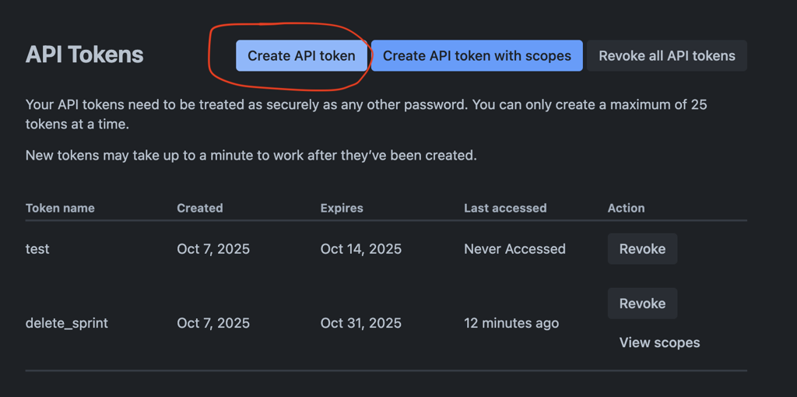

# How to delete stale jira sprints

jira sprints of delted projects got staled, and it's still available as an option from dropdown list

found this REST API to delete jira sprint: https://developer.atlassian.com/cloud/jira/software/rest/api-group-sprint/#api-rest-agile-1-0-sprint-sprintid-delete



```bash
curl --request DELETE -u <your-email>:<your-api-token> --url https://tuana9a.atlassian.net/rest/agile/1.0/sprint/18
```
